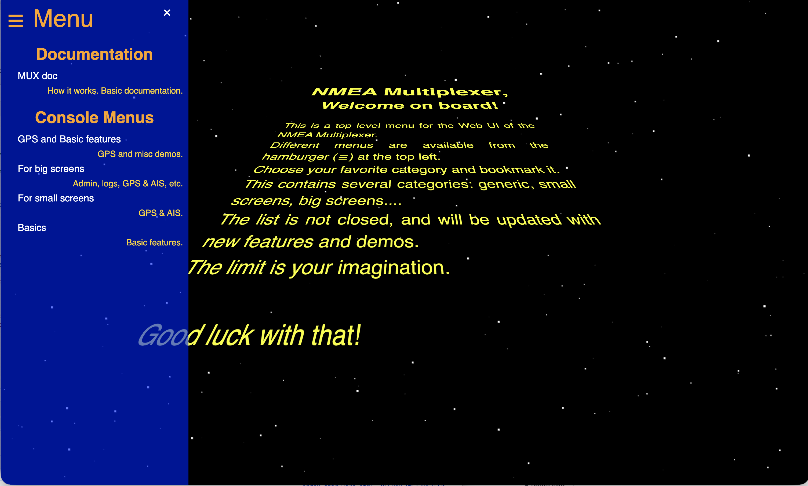

# Some use-cases

> _**Note**_: We will be talking here about Raspberry Pi - and similar boards.  
> The advantage(s) of the Raspberry Pi is that it just need a 5v power supply, and runs a clone of Linux (Debian, RasPiOS or so),
> which is an OpenSource software.  
> 
> ---
> _**BUT**_: If you have an "old laptop", that can run on a 12v adapter, and on which you can install
> a Linux OS, the software presented here would work smoothly on a boat!  
> Linux is not the only OS the software can run on, but this is out of the scope of this document. 

The goal here is to present several use-cases, from the simplest (and cheapest) one, to more elaborated (and expensive) configurations.

The "simplest" configuration would involve
- A small Raspberry Pi - like the Raspberry Pi Zero W (or similar PCB - I need to test the Orange Pi...), it does not even need a screen.
- A simple GPS, plugged into the Raspberry Pi with its USB socket.

> _**Note**_: We limit here the connected devices to a simple USB GPS.  
> More data can obviously be obtained from the boat's electronic. `ShipModul` and other such
> devices allow an `NMEA0183` flow to be read from the USB port of any computer.

From such a configuration, we would be able to read the GPS data, like Position, Course Over Ground, Speed Over Ground, etc.  
Those data can be logged, used for further computations, and/or forwarded to other consumers.  
The Raspberry Pi is able to emit its own network (HotSpot), so other devices (laptops, tablets, cell-phone) can connect to it,
and use - for example - a web browser to display the data we're interested in. The web interface does _**not**_ require any external libraries, it's 100% autonomous, and does _**not**_ need an Internet connection.  
Many protocols are supported, like HTML, REST, TCP, UDP, GPSd, WebSockets, and more.  
All this is supported by a server entirely written for the occasion, and designed to be as small as possible, and consuming as few energy as possible (see details in this repo).  

Here is the high-level welcome page:  


The core server is written in Java, so it can be ported to several machines and OSs without having to be re-built.

We present here several Raspberry Pis, but other machines can fit too. If you have - let's say - an old laptop that can be 
plugged in the boat (i.e. it has a power adapter that does not need an electrical inverter), it could probably be used here!

---

> _**Note**_: If you're not familiar enough with the required commands, do take a look at
> the script named `start.from.scratch.sh`, located at the [root of the repo](../../../start.from.scratch.sh).

First, make sure the soft can be built smoothly, from the machine where the git repo was cloned:
```
machine-a [NMEA-multiplexer] $ ../../gradlew shadowJar -x :astro-computer:AstroComputer:compileScala
```

> _**Warning**_: This page summarizes a list of _**examples**_. The deployment processes go in two steps:
> - You choose your config (Raspberry Pi model, sensors, actuators, etc).
>   - This config may involve Web pages, customizable at will. Some are provided here, you're obviously free to develop your own.
>   - This will be summarized by a `yaml` file, used to drive the multiplexer at runtime. 
> - You deploy it for prod.

# Content
- Deploy for prod, [Raspberry Pi and GPS]  
  Generic example, showing how to deploy _your_ configuration to prod.  
  In a separate document, [here](./use_cases/USE_CASES_1.md).
- A Raspberry Pi A+, with a GPS, a BME280, and a 128x64 SSD1306 (using SPI), push buttons.  
  How to set up a Raspberry Pi A+, with a GPS, a BME280, and a 128x64 SSD1306. Two push-buttons.  
  In a separate document, [here](./use_cases/USE_CASES_2.md).
- Deploy for prod, [Raspberry Pi, GPS, BME280, SSD1306, push buttons]  
  Deploy the config above for prod.  
  In a separate document, [here](./use_cases/USE_CASES_3.md).
- Basic (and functional) data recorder, deploy for prod, [Raspberry Pi, BMP180]  
  A Barograph (Atmospheric Pressure recorder).    
  In a separate document, [here](./use_cases/USE_CASES_4.md).
- The smallest (and cheapest) Navigation Station. Raspberry Pi Zero W, GPS, optional e-ink bonnet. In a separate document, [here](./HOWTO.md).
- A stronger configuration. Raspberry Pi 4B, GPS, screen, keyboard.... In a separate document, [here](./use_cases/USE_CASES_5.md).
- This list is not closed - nor closeable.  
  Also see [here](https://hocus-blogus.blogspot.com/2021/01/several-configurations-for-raspberry-pi.html), several RPi configs...

# 3D-printed enclosures
Some are available from another [git repo](https://github.com/OlivierLD/3DPrinting/blob/master/OpenSCAD/RPiA%2BLogger/README.md) (open source again), and more!

---