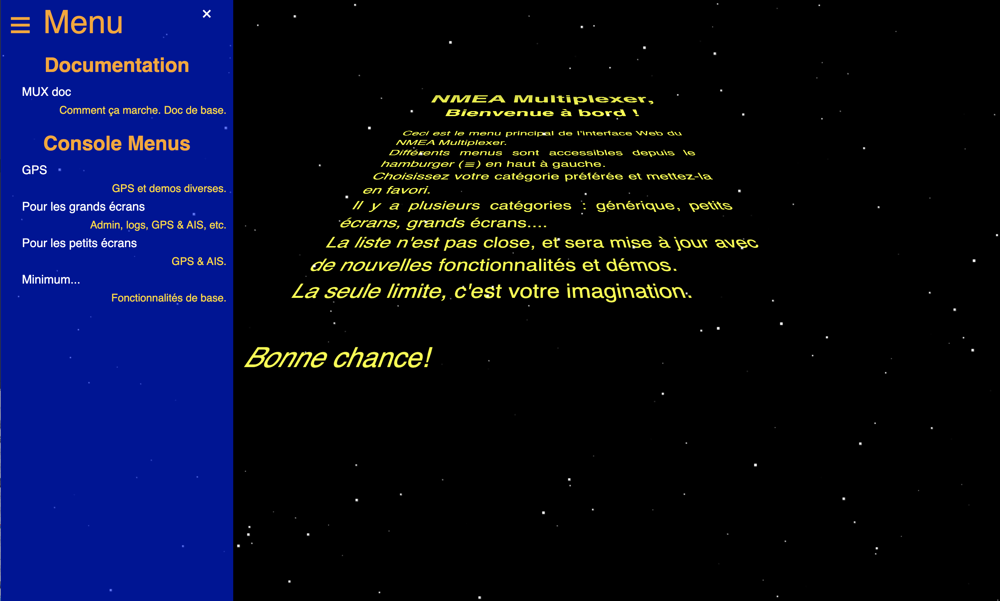

# Quelques options

> _**Note**_ : Nous parlerons ici du Raspberry Pi — et de cartes similaires.
> L'un des avantages du Raspberry Pi est qu'il ne nécessite qu'une alimentation 5 V et qu'il fait fonctionner un système dérivé de Linux (Debian, RasPiOS, etc.),
> qui est un logiciel libre (Open Source).
>
> ---
> _**MAIS**_ : Si vous disposez d'un « vieil ordinateur portable » fonctionnant avec un adaptateur 12 V, sur lequel vous pouvez installer
> un système d'exploitation Linux, le logiciel présenté ici fonctionnera parfaitement à bord d'un bateau !
> Linux n'est pas le seul système d'exploitation compatible avec ce logiciel, mais cela sort du cadre de ce document.

L'objectif ici est de présenter plusieurs options, allant de la configuration la plus simple (et la moins coûteuse) à des installations plus élaborées (et plus onéreuses).

La configuration « la plus simple » comprendrait :
- Un petit Raspberry Pi — comme le Raspberry Pi Zero W (ou une carte similaire ; il faudrait que je teste l'Orange Pi...) — qui ne nécessite même pas d'écran.
- Un simple GPS, branché sur le Raspberry Pi via un port USB.

> _**Note**_ : Nous nous limitons ici à un seul périphérique connecté : un GPS USB.
> Il est évidemment possible d'obtenir davantage de données depuis l'électronique du bateau. Des appareils comme le `ShipModul` (et d'autres équipements similaires)
> permettent de récupérer un flux `NMEA0183` via le port USB de n'importe quel ordinateur.

Avec une telle configuration, il est possible de lire les données GPS, telles que la position, la route fond, la vitesse fond, etc.
Ces données peuvent être enregistrées, utilisées pour des calculs ultérieurs et/ou transmises à d'autres systèmes ou applications. Le Raspberry Pi est capable de générer son propre réseau (point d'accès ou « hotspot »), permettant ainsi à d'autres appareils (ordinateurs portables, tablettes, téléphones mobiles) de s'y connecter.
Ils peuvent alors utiliser, par exemple, un navigateur web pour afficher les données qui nous intéressent. <span style="color: orange;">L'interface web ne nécessite _**aucune**_ bibliothèque externe ; elle est totalement autonome et ne requiert _**pas**_ de connexion Internet.</span>
> **_Toutes_** les interfaces graphiques utilisateur sont conçues en utilisant HTML5, CSS3, ES6 et d'autres _standards_
> définis par le [W3C](https://www.w3.org/).

De nombreux protocoles sont pris en charge, tels que HTML, REST, TCP, UDP, GPSd, WebSockets, etc. Cela permet une communication fluide entre le multiplexeur et d'autres programmes.

L'ensemble repose sur un serveur développé spécifiquement pour ce projet, conçu pour être le plus léger possible et consommer un minimum d'énergie (voir les détails dans ce référentiel).

Voici la page d'accueil principale :


Le serveur central est écrit en Java, ce qui permet de l'utiliser sur différentes machines et systèmes d'exploitation sans avoir besoin de le recompiler.

Bien que nous présentions ici l'utilisation de Raspberry Pi, d'autres types de machines peuvent convenir. Par exemple, si vous disposez d'un ancien ordinateur portable pouvant être branché à bord du bateau (c'est-à-dire doté d'un adaptateur secteur ne nécessitant pas de convertisseur électrique), il pourrait tout à fait être utilisé ici !

---

> _**Remarque**_ : Si vous n'êtes pas familier avec les commandes nécessaires, n'hésitez pas à consulter
> le script nommé `start.from.scratch.sh`, situé à la [racine du référentiel](../../../start.from.scratch.sh). Tout d'abord, assurez-vous que le logiciel peut être compilé sans problème, depuis la machine sur laquelle le référentiel Git a été cloné :
```
machine-a [NMEA-multiplexer] $ ../../gradlew shadowJar -x :astro-computer:AstroComputer:compileScala
```

> _**Avertissement**_ : Cette page présente une série d'**exemples**. Le processus de déploiement se déroule en deux étapes :
> - Vous définissez votre configuration (modèle de Raspberry Pi, capteurs, actionneurs, etc.).
    >   - Cette configuration peut inclure des pages Web, personnalisables à volonté. Quelques exemples sont fournis ici, mais vous êtes bien entendu libre de développer les vôtres.
>   - L'ensemble est résumé dans un fichier `yaml`, qui servira à piloter le multiplexeur lors de son exécution.
> - Vous procédez au déploiement en environnement de production.

# Sommaire
- Déploiement en production : [Raspberry Pi et GPS]
  Exemple générique illustrant comment déployer _votre_ configuration en production.
  Disponible dans un document séparé, [ici](./use_cases/USE_CASES_1_fr.md).
- Raspberry Pi A+ avec GPS, capteur BME280, écran SSD1306 (128x64, via SPI) et boutons-poussoirs.
  Configuration d'un Raspberry Pi A+ équipé d'un GPS, d'un capteur BME280, d'un écran SSD1306 (128x64) et de deux boutons-poussoirs.
  Disponible dans un document séparé, [ici](./use_cases/USE_CASES_2_fr.md).
- Déploiement en production : [Raspberry Pi, GPS, BME280, SSD1306, boutons-poussoirs]
  Déploiement de la configuration ci-dessus en environnement de production.
  Disponible dans un document séparé, [ici](./use_cases/USE_CASES_3_fr.md).
- Enregistreur de données basique (mais fonctionnel) – déploiement en production : [Raspberry Pi, BMP180]
  Un barographe (enregistreur de pression atmosphérique).
  Disponible dans un document séparé, [ici](./use_cases/USE_CASES_4_fr.md). - La station de navigation la plus petite (et la moins coûteuse). Raspberry Pi Zero W, GPS, écran à encre électronique (e-ink) en option. Détails dans un document séparé, [ici](./HOWTO.md).
- Une configuration plus robuste. Raspberry Pi 4B, GPS, écran, clavier... Détails dans un document séparé, [ici](./use_cases/USE_CASES_5_fr.md).
- Cette liste n'est pas exhaustive — et ne saurait l'être.  
  Voir également [ici](https://hocus-blogus.blogspot.com/2021/01/several-configurations-for-raspberry-pi.html) pour d'autres configurations basées sur Raspberry Pi...

# Boîtiers imprimés en 3D
Certains modèles sont disponibles dans un autre [référentiel Git](https://github.com/OlivierLD/3DPrinting/blob/master/OpenSCAD/RPiA%2BLogger/README.md) (en open source).