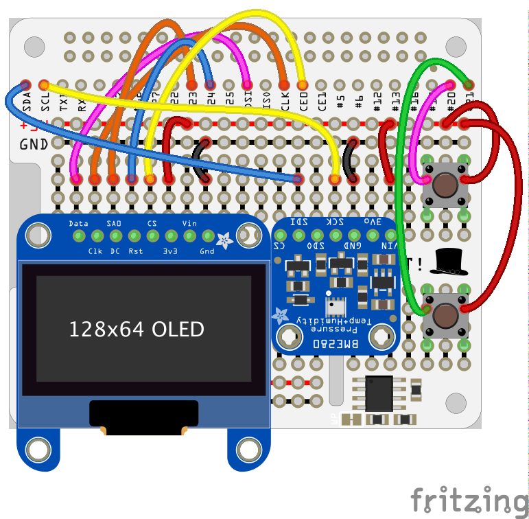
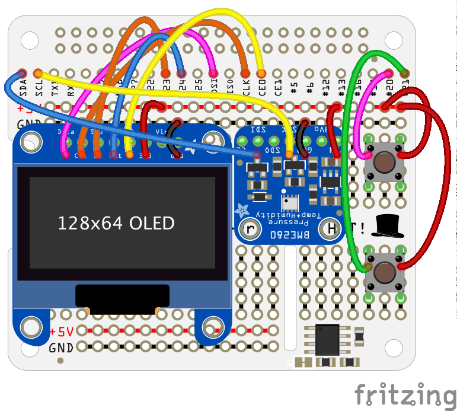
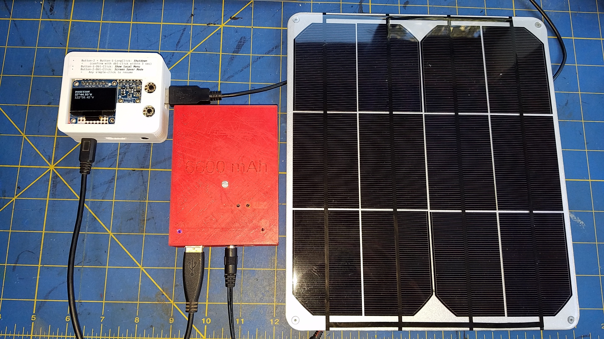
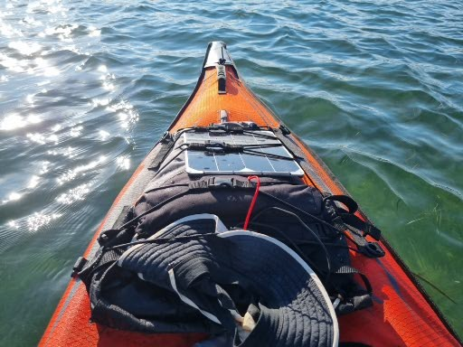

# Option 2
### Un Raspberry Pi A+, équipé d'un GPS, d'un capteur BME280 et d'un écran OLED SSD1306 128x64 (utilisant ici l'interface SPI)
> Adapté à la randonnée, au kayak, ou à d'autres activités similaires.
> La position est obtenue via un GPS série, et les données atmosphériques proviennent d'un [BME280](https://www.adafruit.com/product/2652).
> Les données sont affichées sur un [petit écran OLED](https://www.adafruit.com/product/326) et enregistrées dans un fichier, afin de pouvoir être consultées ultérieurement.

**Dans ce qui suit, nous supposons que l'adresse de la carte que vous utilisez est `192.168.1.103`.**

_**Tout d'abord, lancez les serveurs Python**_ pour le BME280 et le SSD1306.
Veillez à utiliser les ports appropriés.

#### Lecture des données du BME280
```
$ ../../RaspberryPythonServers/python/scripts/start.BME280.TCP.server.sh
~/repos/ROB/raspberry-sailor/NMEA-multiplexer ~/repos/ROB/raspberry-sailor/MUX-implementations/NMEA-multiplexer-basic
Exécution depuis /home/pi/repos/ROB/raspberry-sailor/RaspberryPythonServers/python
Succès : 192.168.1.103
Saisissez le nom de la machine - Par défaut [192.168.1.103] >
Saisissez le port HTTP - Par défaut [9999] > 8001
Mode verbeux (true ou false) ?
``` - Par défaut [false] >
Exécution de python3 ./TCP_BME280_server.py --machine-name:192.168.1.103 --port:8001 --verbose:false
Terminé
Utilisez ./scripts/kill.python.tcp.sh pour arrêter le serveur.

Utilisation :
python3 /home/pi/repos/ROB/raspberry-sailor/RaspberryPythonServers/python/scripts/TCP_BME280_server.py [--machine-name:127.0.0.1] [--port:7001] [--verbose:true|false]
où --machine-name: et --port: doivent correspondre aux paramètres du contexte.

Le serveur est à l'écoute. [Ctrl-C] permet d'arrêter le processus.
. . .
```
Le port indiqué ci-dessus (`8001`) est celui défini dans `nmea.mux.kayak.ssd1306.yaml` :
```yaml
channels:
- . . . 
- type: tcp
  server: 192.168.1.103
  port: 8001
  verbose: false

```

#### Réception de données et affichage sur l'écran OLED SSD1306
```
$ ../../RaspberryPythonServers/python/scripts/start.SSD1306.REST.server.sh
~/repos/ROB/raspberry-sailor/NMEA-multiplexer ~/repos/ROB/raspberry-sailor/MUX-implementations/NMEA-multiplexer-basic
Exécution depuis /home/pi/repos/ROB/raspberry-sailor/RaspberryPythonServers/python
Succès : 192.168.1.103
Saisir le nom de la machine - Par défaut [192.168.1.103] >
Saisir le port HTTP - Par défaut [9999] > 8080
Mode verbeux (true ou false) ? - Par défaut [false] >
Hauteur de l'écran (32 ou 64) ? - Par défaut [32] > 64
Option de câblage (I2C ou SPI) ? - Par défaut [I2C] > SPI
Exécution de python3 s./REST_SSD1306_server.py --machine-name:192.168.1.103 --port:8080 --verbose:false --height:64 --wiring:SPI
Terminé
Utilisez ./scripts/kill.python.rest.sh pour arrêter le serveur.
- Essayez : curl -X PUT http://192.168.1.103:8080/ssd1306/nmea-data -d 'This is|a test.' - Essayez `curl -X GET http://192.168.1.103:8080/ssd1306/oplist`
~/repos/ROB/raspberry-sailor/MUX-implementations/NMEA-multiplexer-basic
Utilisation de RESET D24
Utilisation de CS D8
Utilisation de DC D23
Démarrage du serveur SSD1306 sur le port 8080
Essayez `curl -X GET http://192.168.1.103:8080/ssd1306/oplist`
ou `curl -v -X VIEW http://192.168.1.103:8080/ssd1306 -H "Content-Length: 1" -d "1"`
. . . Le port `8080` est celui défini dans `REST.ssd1306.dg.properties` (« dg » signifie **D**ele**G**ate) :
```properties
ssd1306.dg.protocol=http
ssd1306.dg.server-name=192.168.1.103
ssd1306.dg.port=8080
ssd1306.dg.verb=PUT
ssd1306.dg.resource=/ssd1306/nmea-data
ssd1306.dg.verbose=false
```

Maintenant que les capteurs et l'actionneur sont en place, lancez le multiplexeur avec `nmea.mux.kayak.ssd1306.yaml` :

```
$ ./mux.sh nmea.mux.kayak.ssd1306.yaml
Using properties file nmea.mux.kayak.ssd1306.yaml
Running sudo java  -Djava.library.path=/usr/lib/jni -Drmc.decl.only=true -Dscreen.verbose=true -Drest.feeder.verbose=true -Dparse.ais=true -Dmux.props.verbose=true -Dprocess.on.start=true -Dmux.properties=nmea.mux.kayak.ssd1306.yaml -Dno.ais=false -Dcalculate.solar.with.eot=true -Ddefault.mux.latitude=37.8218 -Ddefault.mux.longitude=-122.3112 -Dtry.to.speak=true -Djava.util.logging.config.file=./logging.properties   -cp ./build/libs/NMEA-multiplexer-basic-1.0-all.jar:/usr/share/java/RXTXcomm.jar nmea.mux.GenericNMEAMultiplexer
{with.http.server=true,
``` http.port=9999, init.cache=true, damping=30}
Nom de la définition : Enregistrement des données depuis le kayak
-- Description --
Un GPS sur /dev/ttyS80
Un capteur BME280 lu via un serveur TCP en Python, sur le port 8001
Affichage sur un écran SSD1306 128x64
Enregistrement des données dans un fichier
-----------------
Journalisation activée globalement, niveau INFO
Modèle de nom de fichier de journalisation : null
- Début de l'écriture vers nmea.forwarders.DataFileWriter, ./data.nmea
Démarrage d'un nouveau http.HTTPServer (mode verbeux : désactivé)
Bibliothèque stable
=========================================
Version de la bibliothèque native = RXTX-2.2pre2
Version de la bibliothèque Java = RXTX-2.1-7
AVERTISSEMENT : Incohérence de version RXTX
Version du fichier JAR = RXTX-2.1-7
Version de la bibliothèque native = RXTX-2.2pre2
1 675 177 415 348 - Port ouvert : 9999
1 675 177 415 351 - http.HTTPServer accepte désormais les requêtes
1 client est actuellement connecté.
Connexion établie par le client <socket.socket fd=9, family=AddressFamily.AF_INET, type=SocketKind.SOCK_STREAM, proto=0, laddr=('192.168.1.103', 8001), raddr=('192.168.1.103', 39686)>
Nouvel écouteur client
Le statut d'accès au port /dev/ttyS80 a changé : type=1, Occupé (Verrouillé)
Il s'agit d'une liaison sérieal port
Lecture du port série...
/dev/ttyS80:4800  > Port ouvert...
. . .
```
> _**Remarque**_ : si le port série du GPS pose problème, exécutez le script
> `../RESTNavServer/mk.link.sh` ...

Les données sont lues, affichées et enregistrées.
Vous pouvez également suivre ce qui se passe via un navigateur (le nom de la machine et le port sont susceptibles de varier) :
- <http://192.168.1.103:9999/web/index.html>

L'interface web présentée ci-dessus est conçue pour s'adapter à diverses configurations. Par exemple,
dans ce cas précis (avec un GPS et un capteur BME280 comme sources de données), il est possible que la « vitesse du vent réel » (True Wind Speed) ne s'affiche pas 🤔...
Rappelons que les pages web présentées ici ne sont que des exemples illustrant la manière d'exploiter les données disponibles dans le cache du multiplexeur, via des services REST.
> _**Remarque**_ : Le Raspberry Pi peut générer son propre réseau, auquel vous pouvez connecter d'autres appareils (ordinateurs portables, tablettes, téléphones mobiles, montres connectées, etc.). Voir
> [ici](../../../../HintsAndTips.md#ad-hoc--hotspot-networking).
> De même, il est possible d'accéder au Raspberry Pi depuis d'autres appareils via `ssh`.

#### Détails
Câblage, schémas, composants, boîtiers imprimés en 3D...

Sur un [PiHAT](https://www.adafruit.com/product/2310) (HAT : **H**ardware **A**ttached on **T**op) :

| Câblage |
|:-----------------------------------------:|
| Composants décalés vers le bas pour rendre le câblage visible |
|  |
| Position réelle des composants |
|  |

Boîtier imprimé en 3D, disponible
- [ici](https://github.com/OlivierLD/3DPrinting/tree/master/OpenSCAD/RPiA%2BLogger).
- [STL, animé](https://github.com/OlivierLD/3DPrinting/blob/master/OpenSCAD/RPiA%2BLogger/rpi.aplus.enclosure.full.stl).

|                            En route                            |
|:--------------------------------------------------------------:|
|  |
|             |

---