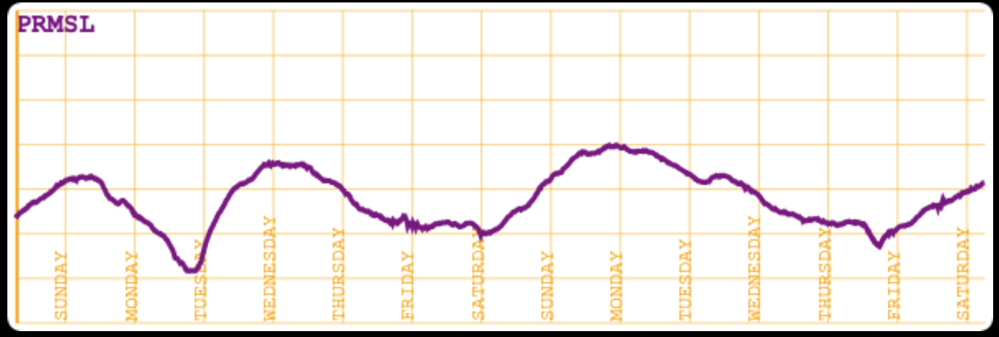
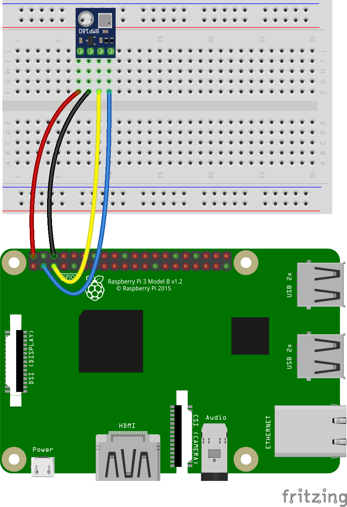

# Option 4 : Station météo de base
### Un Raspberry Pi, équipé d'un capteur BMP180 (ou BMP280, BME280, en cours de développement)

#### Lecture des données du capteur
```
$ ../../RaspberryPythonServers/python/scripts/start.BMP180.TCP.server.sh
~/repos/ROB/raspberry-sailor/NMEA-multiplexer ~/repos/ROB/raspberry-sailor/MUX-implementations/NMEA-multiplexer-basic
Exécution depuis /home/pi/repos/ROB/raspberry-sailor/RaspberryPythonServers/python
Succès : 192.168.1.103
Saisissez le nom de la machine - Par défaut [192.168.1.103] > 127.0.0.1
Saisissez le port HTTP - Par défaut [9999] > 8001
Mode verbeux (true ou false) ? - Par défaut [false] >
Exécution de python3 ./TCP_BMP180_server.py --machine-name:127.0.0.1 --port:8001 --verbose:false
Terminé
Utilisez ./scripts/kill.python.tcp.sh pour arrêter le serveur.

Utilisation :
python3 /home/pi/repos/ROB/raspberry-sailor/RaspberryPythonServers/python/scripts/TCP_BMP180_server.py [--machine-name:127.0.0.1] [--port:7001] [--verbose:true|false]
où --machine-name: et --port: doivent correspondre aux paramètres définis dans le contexte.

Le serveur est à l'écoute. [Ctrl-C] permet d'arrêter le processus.
. . .
```
Le port indiqué ci-dessus (`8001`) est celui défini dans le fichier `nmea.mux.bmp180.yaml` :
```yaml
channels:
- . . . 
- type: tcp
  server: 127.0.0.1
  port: 8001
  verbose: false
```

#### Exigence spécifique : Données à long terme
Un barographe est un instrument très utile pour la météorologie marine et les prévisions.
Cependant, il peut s'avérer assez coûteux (voir [ici](https://www.naudet.com/barometre-enregistreur-c102x2726134)). Nous allons tenter d'en concevoir un à l'aide d'un Raspberry Pi Zero et d'un capteur tel que le BME280 (pour moins de 2,00 $).

L'objectif est de pouvoir afficher une courbe, semblable à celle produite par un barographe, comme illustré ci-dessous :



Elle permet de visualiser les données sur une période d'une semaine (voire plus). Il est nécessaire de disposer d'un composant côté serveur pour stocker ces données et les restituer à la demande.
Comme le serveur (multiplexeur) fonctionne en continu (24h/24 et 7j/7), cela ne devrait poser aucun problème.
La version 1 (V1) est disponible ; consultez le fichier `yaml`.


#### Détails
Câblage, schémas, composants, boîtiers imprimés en 3D...

| Câblage I2C (VIN, GND, SCL, SDA)      |
|:-----------------------------------------:|
|  |

Boîtier imprimé en 3D : voir <https://www.thingiverse.com/thing:1067700>

Pour des boîtiers imprimés en 3D destinés au Raspberry Pi et à d'autres composants, consultez [cette page](https://github.com/OlivierLD/3DPrinting/blob/master/OpenSCAD/RPiDevBoards/NavStations/README.md#with-a-bme280-for-prmsl). #### Exécution
À faire : adresse I2C : 0x77, 0x76...
```
../../RaspberryPythonServers/python/scripts/start.BMP180.TCP.server.sh
Saisir le nom de la machine > 127.0.0.1
Saisir le port TCP > 8001
Mode verbeux (Verbose) > false
. . .
./mux.sh nmea.mux.bmp180.yaml
```

#### Voir aussi
- `to.prod.sh`
- Barographe, thermographe
- . . .

#### Résumé
À venir...

---