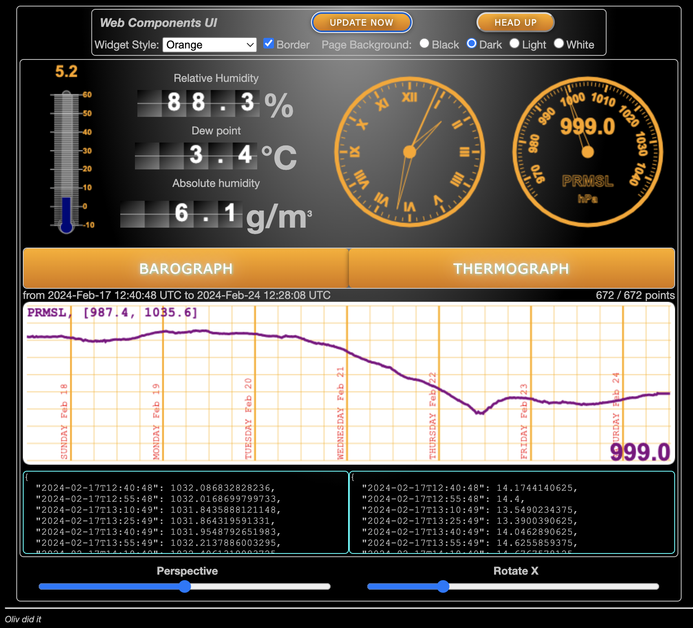

_**Note**_: the links below are just examples, provided to have an idea of the cost of the different components. Components are available from several providers, and prices may vary.

---

# Full Stack

- [Raspberry Pi 4B, 4Go](https://www.kubii.com/fr/cartes-nano-ordinateurs/2772-raspberry-pi-4-modele-b-4gb-5056561800349.html)
  - To be tested, [Orange Pi](https://fr.aliexpress.com/item/1005010198029047.html?spm=a2g0o.tm1000063736.appPushSupportRecommend.2.2a2837c2ZYTEkR&gps-id=appPushSupportRecommend&scm=1007.67346.516851.0&scm_id=1007.67346.516851.0&scm-url=1007.67346.516851.0&pvid=a40564af-e6b5-47da-a411-176647958039&_t=gps-id%3AappPushSupportRecommend%2Cscm-url%3A1007.67346.516851.0%2Cpvid%3Aa40564af-e6b5-47da-a411-176647958039%2Ctpp_buckets%3A668%232846%238107%231934&pdp_ext_f=%7B%22order%22%3A%22869%22%2C%22spu_best_type%22%3A%22price%22%2C%22eval%22%3A%221%22%2C%22sceneId%22%3A%2257346%22%2C%22fromPage%22%3A%22recommend%22%7D&pdp_npi=6%40dis%21EUR%2159.99%2159.99%21%21%2165.77%2165.77%21%40210384a717917310095573143e0ce3%2112000051496788840%21rec%21FR%211894764174%21XZ%211%210%21n_tag%3A-29919%3Bd%3A9594669f%3Bm03_new_user%3A-29895&utparam-url=scene%3AappPushSupportRecommend%7Cquery_from%3A%7Cx_object_id%3A1005010198029047%7C_p_origin_prod%3A)...
- [In a box](https://www.kubii.com/fr/boitiers-fixations/2681-boitier-officiel-pour-raspberry-pi-4-3272496298583.html)
- A Screen (power supply 12v, or USB), with an HDMI cord. Like [this](https://www.amazon.fr/Yodoit-Portable-Moniteur-B%C3%A9quille-Haut-parleurs/dp/B0F82M3GHX/ref=asc_df_B0F82M3GHX?mcid=b898da6d55c23e2897ce0722a272fa60&tag=googshopfr-21&linkCode=df0&hvadid=701511851432&hvpos=&hvnetw=g&hvrand=13635281505204187963&hvpone=&hvptwo=&hvqmt=&hvdev=c&hvdvcmdl=&hvlocint=&hvlocphy=9109278&hvtargid=pla-2451665989584&hvocijid=13635281505204187963-B0F82M3GHX-&hvexpln=0&th=1).
- [Keyboard](https://www.pearl.fr/article/TG1541/clavier-usb-lumineux-azerty-avec-pave-numerique) (QWERTY or AZERTY...)
- Mouse, Trackball, or track pad (many options to choose from, your job!)

## AIS _Receiver_ Option
- [Wegmatt](https://wegmatt.com/).
- [Get started](https://wegmatt.com/files/dAISy%20HAT%20AIS%20Receiver%20Quickstart.pdf)
- [Raspberry Pi AIS-HAT, WegMatt](https://shop.wegmatt.com/products/daisy-hat-ais-receiver)
- [Raspberry Pi AIS-HAT, OpenMarine](https://shop.openmarine.net/home/14-daisy-hat-ais-receiver.html)

## Extra
- A [BME280](https://www.adafruit.com/product/2652) or [BMP180](https://www.alibaba.com/pla/BMP180-GY-68-33V-5V-BMP-180-Temperature_1601258226008.html?mark=google_shopping&biz=pla&searchText=electronic+components&product_id=1601258226008&pcy=fr_fr&src=sem_ggl&field=UG&from=sem_ggl&cmpgn=22889997309&adgrp=184184039735&fditm=&tgt=pla-2426194943436&locintrst=&locphyscl=9109278&mtchtyp=&ntwrk=g&device=c&dvcmdl=&creative=769301584071&plcmnt=&plcmntcat=&aceid=&position=&gad_source=1&gad_campaignid=22889997309&gbraid=0AAAAAD8m77prknzKuHOPnobJhLRJhaNn3&gclid=CjwKCAjwoaLWBhAWEiwAnyituwUAFi1j_D2e30QtmCTB03nXi-rumaNeVdon_UWhQrmVl2fDIs2BDRoC9ygQAvD_BwE) can be useful to get the atmospheric pressure and air temperature.   
  _This one needs not to be too close to the CPU of the Raspberry Pi, as the temperature of the CPU
  might impact your measures._  
- Those data can be used to display graphs, like this:  
  

---

### Context
The Raspberry Pi emits its own network (yes, you can have a network, and no Internet...), and is connected to the boat's sensors (ShipModul or so), speaking NMEA-0183.  
Data can be visualized on the screen connected to the Raspberry Pi, or from any network-aware device, with a (recent, or at least not too old) browser.  
The Raspberry Pi is strong and powerful enough to host programs like [OpenCPN](https://opencpn.org/).  
The Multiplexer (options to be defined, technical doc [here](https://github.com/OlivierLD/ROB/blob/master/raspberry-sailor/NMEA-multiplexer/manual.md) - don't be scared, we'll help you) is also running on the Raspberry Pi.  
An OS like [Twister OS](https://twisteros.com/) is a very good option.
---
Adapters (power supply, HDMI sockets, serial/USB ports) and SD Card have to be provided as well.  
SSD drives also exist.

---