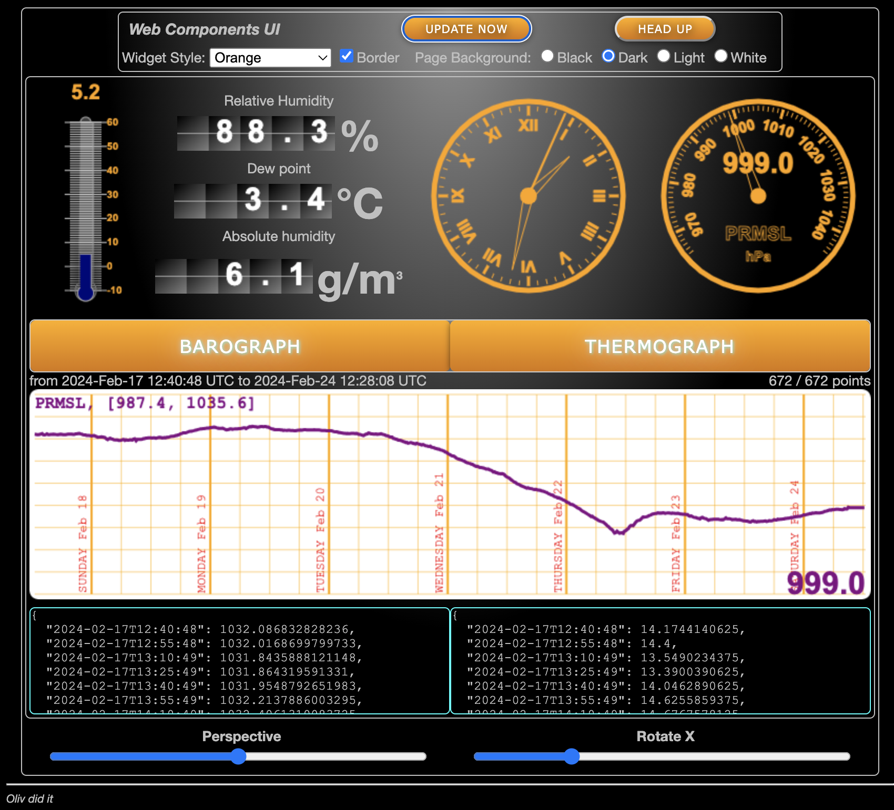

_**Remarque**_ : les liens ci-dessous ne sont que des exemples, fournis pour donner un ordre d'idée du coût des différents composants. Ces composants sont disponibles auprès de plusieurs fournisseurs, et les prix peuvent varier.

---

# Configuration minimale
- Juste un `Raspberry Pi Zero W` et un GPS
  - [raspberripi.com](https://www.raspberrypi.com/products/raspberry-pi-zero-w/)
  - [aliexpress](https://fr.aliexpress.com/item/1005012287292738.html?src=google&src=google&albch=shopping&acnt=297-491-5278&isdl=y&slnk=&plac=&mtctp=&albbt=Google_7_shopping&aff_platform=google&aff_short_key=_oFgTQeV&gclsrc=aw.ds&albagn=888888&ds_e_adid=&ds_e_matchtype=&ds_e_device=c&ds_e_network=x&ds_e_product_group_id=&ds_e_product_id=fr1005012287292738&ds_e_product_merchant_id=5852344715&ds_e_product_country=FR&ds_e_product_language=fr&ds_e_product_channel=online&ds_e_product_store_id=&ds_url_v=2&albcp=23484074629&albag=&isSmbAutoCall=false&needSmbHouyi=false&gad_source=1&gad_campaignid=23479465904&gbraid=0AAAABCRGU4k-Jf-MFc_eMMUxxlo3Jc1Rg&gclid=Cj0KCQiA8aTYBhCvARIsAJFINld6EsRalpdUKeVXaV29_vKOUyXSjM7r16t9wrloKFifh-pDYbE5EEcaAkYkEALw_wcB)
  - [Kubii](https://www.kubii.com/fr/cartes-nano-ordinateurs/1851-raspberry-pi-zero-w-kubii-3272496006997.html)
- Les prix sont pour le moins disparates...
- Alimentation : Allume-cigare et un adaptateur USB, avec un adapter USB et un cable (A to micro-B)
- Le Raspberry Pi Zero ne dispose d'aucune interface directe (ni écran, ni clavier). Il génère son propre réseau, auquel vous pouvez vous connecter via un smartphone, une tablette ou tout autre appareil (aucune carte SIM n'est requise), afin d'accéder aux différentes interfaces (administration et exécution) par le biais d'un navigateur web. Les protocoles `ssh` et `scp` sont également — naturellement — disponibles.
- Le GPS (et/ou d'autres sources de données NMEA) se connecte au port USB du Raspberry Pi.

# Full Stack

- [Raspberry Pi 4B, 4 Go](https://www.kubii.com/fr/cartes-nano-ordinateurs/2772-raspberry-pi-4-modele-b-4gb-5056561800349.html)
- À tester : [Orange Pi](https://fr.aliexpress.com/item/1005010198029047.html?spm=a2g0o.tm1000063736.appPushSupportRecommend.2.2a2837c2ZYTEkR&gps-id=appPushSupportRecommend&scm=1007.67346.516851.0&scm_id=1007.67346.516851.0&scm-url=1007.67346.516851.0&pvid=a40564af-e6b5-47da-a411-176647958039&_t=gps-id%3AappPushSupportRecommend%2Cscm-url%3A1007.67346.516851.0%2Cpvid%3Aa40564af-e6b5-47da-a411-176647958039%2Ctpp_buckets%3A668%232846%238107%231934&pdp_ext_f=%7B%22order%22%3A%22869%22%2C%22spu_best_type%22%3A%22price%22%2C%22eval%22%3A%221%22%2C%22sceneId%22%3A%2257346%22%2C%22fromPage%22%3A%22recommend%22%7D&pdp_npi=6%40dis%21EUR%2159.99%2159.99%21%21%2165.77%2165.77%21%40210384a717917310095573143e0ce3%2112000051496788840%21rec%21FR%211894764174%21XZ%211%210%21n_tag%3A-29919%3Bd%3A9594669f%3Bm03_new_user%3A-29895&utparam-url=scene%3AappPushSupportRecommend%7Cquery_from%3A%7Cx_object_id%3A1005010198029047%7C_p_origin_prod%3A).
  - Les tests ne sont pas vraiment concluants pour le moment...
- [Dans un boîtier](https://www.kubii.com/fr/boitiers-fixations/2681-boitier-officiel-pour-raspberry-pi-4-3272496298583.html)
- Un écran (avec alimentation 12 V ou USB) et un câble HDMI. Comme [celui-ci](https://www.amazon.fr/Yodoit-Portable-Moniteur-B%C3%A9quille-Haut-parleurs/dp/B0F82M3GHX/ref=asc_df_B0F82M3GHX?mcid=b898da6d55c23e2897ce0722a272fa60&tag=googshopfr-21&linkCode=df0&hvadid=701511851432&hvpos=&hvnetw=g&hvrand=13635281505204187963&hvpone=&hvptwo=&hvqmt=&hvdev=c&hvdvcmdl=&hvlocint=&hvlocphy=9109278&hvtargid=pla-2451665989584&hvocijid=13635281505204187963-B0F82M3GHX-&hvexpln=0&th=1) 
- [Clavier](https://www.pearl.fr/article/TG1541/clavier-usb-lumineux-azerty-avec-pave-numerique) (QWERTY ou AZERTY)
- Souris, trackball ou pavé tactile (il existe de nombreuses options, à vous de choisir !)
- En option, un [SSD](https://www.kubii.com/fr/boitiers-ventiles-intelligents/3139-boitier-argon-one-m2-3272496304116.html?gad_source=1&gad_campaignid=22579261906&gbraid=0AAAAApc7Y9kvwyEFC9LEbX0w5hLkZ_Fzo&gclid=CjwKCAjwoaLWBhAWEiwAnyitu6nbPiqGCjoZMldFi2hCN01qy4V5w_FkLt84cegmc-_cXhJvLFxzfhoCIcMQAvD_BwE) (Solid State Drive) au lieu d'une carte SD

## Option : Récepteur AIS
- [Wegmatt](https://wegmatt.com/).
- [Guide de démarrage](https://wegmatt.com/files/dAISy%20HAT%20AIS%20Receiver%20Quickstart.pdf)
- [Raspberry Pi AIS-HAT, WegMatt](https://shop.wegmatt.com/products/daisy-hat-ais-receiver)
- [Raspberry Pi AIS-HAT, OpenMarine](https://shop.openmarine.net/home/14-daisy-hat-ais-receiver.html)

Nécessite une antenne (de type VHF ; un modèle bon marché suffit). Fonctionne très bien. 

## Supplément
Grâce à son connecteur GPIO (General Purpose Input Output), le Raspberry Pi peut être relié à de nombreux capteurs utilisant divers protocoles, tels que (entre autres) :
la liaison série, SPI (Serial Peripheral Interface) ou I2C (Inter-Integrated Circuit). Disposer d'une mesure de la pression atmosphérique peut s'avérer utile lors de la navigation à la voile...

- Un [BME280](https://www.adafruit.com/product/2652) ou un [BMP180](https://www.alibaba.com/pla/BMP180-GY-68-33V-5V-BMP-180-Temperature_1601258226008.html?mark=google_shopping&biz=pla&searchText=electronic+components&product_id=1601258226008&pcy=fr_fr&src=sem_ggl&field=UG&from=sem_ggl&cmpgn=22889997309&adgrp=184184039735&fditm=&tgt=pla-2426194943436&locintrst=&locphyscl=9109278&mtchtyp=&ntwrk=g&device=c&dvcmdl=&creative=769301584071&plcmnt=&plcmntcat=&aceid=&position=&gad_source=1&gad_campaignid=22889997309&gbraid=0AAAAAD8m77prknzKuHOPnobJhLRJhaNn3&gclid=CjwKCAjwoaLWBhAWEiwAnyituwUAFi1j_D2e30QtmCTB03nXi-rumaNeVdon_UWhQrmVl2fDIs2BDRoC9ygQAvD_BwE) peut être utilisé pour obtenir la pression atmosphérique et la température de l'air (entre autres). _Il est préférable de ne pas placer ce composant trop près du processeur (CPU) du Raspberry Pi, car la température de ce dernier pourrait fausser vos mesures._
- Ces données peuvent être utilisées pour générer des graphiques, comme celui-ci :
  

Pour plus de détails sur le code et le câblage, consultez :
- [ici](../../../RaspberryPythonServers/python/pure.python.bme280/README.md) (en anglais).
- ou [ici](../../../RaspberryPythonServers/python/pure.python.bme280/README_fr.md) (en français).

Dans la même optique, vous pouvez utiliser des compas (HMC5883L), des gyroscopes à trois axes (L3GD20), etc.

---

### Contexte
Le Raspberry Pi génère son propre réseau (oui, il est possible d'avoir un réseau local sans accès à Internet...) et est connecté aux capteurs du bateau (via un équipement de type ShipModul, par exemple), communiquant via le protocole NMEA-0183.
Les données peuvent être visualisées sur un écran relié au Raspberry Pi, ou depuis n'importe quel appareil connecté au réseau, à l'aide d'un navigateur web (récent, ou du moins pas trop ancien).
Le modèle de Raspberry Pi mentionné ici (4B) est suffisamment performant pour faire fonctionner des logiciels tels qu'[OpenCPN](https://opencpn.org/).
Le multiplexeur (options pour......est également exécuté sur le Raspberry Pi (voir la documentation technique [ici](https://github.com/OlivierLD/ROB/blob/master/raspberry-sailor/NMEA-multiplexer/manual.md) — n'ayez crainte, nous sommes là pour vous aider).
Un système d'exploitation comme [Twister OS](https://twisteros.com/) constitue une très bonne option.

---

Il est également nécessaire de prévoir des adaptateurs (alimentation, prises HDMI, ports série/USB) ainsi qu'une carte SD.
Comme mentionné plus haut, il est aussi possible d'utiliser des disques SSD (en option).

---